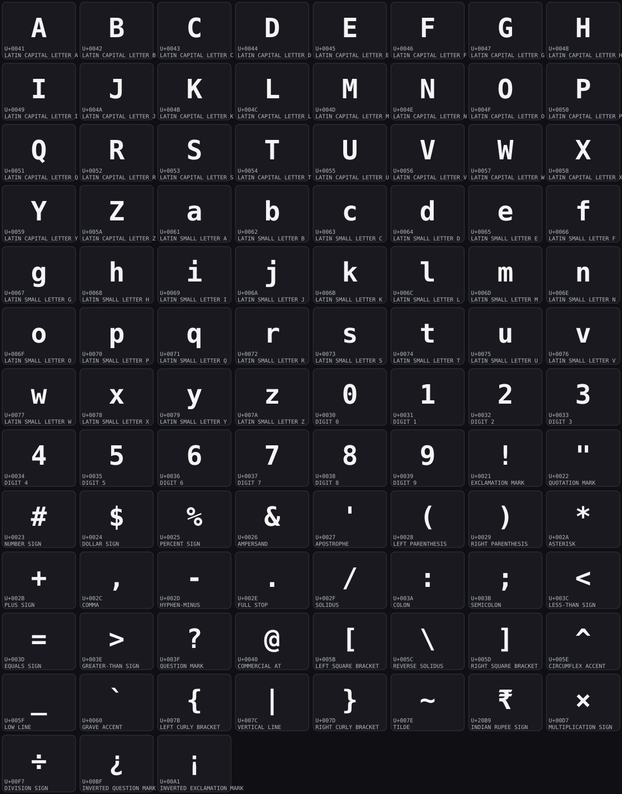

# codeNcoffee-font

<strong>Codencoffee Bold</strong> A screenshot-derived geometric display typeface reconstruction.

## Glyph preview

The full glyph sheet below renders each supported character in the actual font and labels it with its Unicode code point and character name. Open the [interactive glyph atlas](proof/glyph-atlas.html) for a larger view.

[Open the browser specimen](web/index.html) — uppercase, lowercase, digits, punctuation and extra symbols.

## Font files

| File | Intended use |
| --- | --- |
| [fonts/Codencoffee-Bold.woff2](fonts/Codencoffee-Bold.woff2) | Web display font for branding, headlines and short labels |
| Codencoffee-Bold.ttf | Generated by the build script for desktop and native applications |
| Codencoffee-Bold.woff | Generated by the build script as a web fallback |

## Typography roles

Codencoffee currently ships **one weight: Bold (700)**. Its condensed, geometric letterforms and internal cut-outs are designed to create a distinctive display style. Use it for short, high-emphasis text such as product names, page titles, section headings and compact labels.

For paragraphs, descriptions, forms, menus, long documentation and other small UI text, pair it with the platform's normal UI sans-serif font. The package's CSS exposes both roles:

- `.codencoffee-display` (also available as the legacy `.codencoffee` class) uses the bundled Codencoffee font.
- `.codencoffee-text` uses a readable system UI sans-serif stack.

This pairing makes the font package practical in complete interfaces without pretending that the existing Bold outlines are a text-optimized Regular style. A dedicated Codencoffee Text family would require separately designed glyphs, spacing and small-size testing; it is not included in this release.

See [FONT-USAGE.md](FONT-USAGE.md) for web and native-app examples.

## Character coverage

- Uppercase Latin: A–Z
- Lowercase Latin: a–z
- Digits: 0–9
- Printable ASCII punctuation: U+0021–U+007E
- Additional Unicode: ₹ × ÷ ¿ ¡

## Web usage

Load the stylesheet and assign the display and text roles separately:

~~~html
<link rel="stylesheet" href="/path/to/codencoffee.css">
<h1 class="codencoffee-display">Your product name</h1>

Use the platform UI font for readable paragraphs and interface copy.

~~~

Or use the font stack directly:

~~~css
@font-face {
  font-family: "Codencoffee";
  src: url("/fonts/Codencoffee-Bold.woff2") format("woff2");
  font-style: normal;
  font-weight: 700;
  font-display: swap;
}

:root {
  --font-display: "Codencoffee", sans-serif;
  --font-text: ui-sans-serif, system-ui, -apple-system, BlinkMacSystemFont,
    "Segoe UI", sans-serif;
}

h1, .brand { font-family: var(--font-display); font-weight: 700; }
body, p, input, textarea, button { font-family: var(--font-text); }
~~~

## Build and validate

Requirements: Python 3.10+, fonttools and brotli.

~~~bash
python -m pip install fonttools brotli
python tools/build_font.py
~~~

The checked-in WOFF2 is the canonical binary master. The script exports a TTF and WOFF file and validates that all printable ASCII code points remain mapped. It also writes a machine-readable report to proof/QA-REPORT.json.

## Native application guides

- [Android](mobile/android/README.md)
- [iOS](mobile/ios/README.md)
- [Flutter](mobile/flutter/README.md)
- [React Native](mobile/react-native/README.md)

Use Codencoffee for short display text in each platform and retain the platform's default UI font for body copy and dense interface text.

## Repository layout

~~~text
.
├── fonts/Codencoffee-Bold.woff2
├── tools/build_font.py
├── proof/
│   ├── glyph-atlas.html
│   ├── glyph-coverage.svg
│   └── QA-REPORT.json
├── source-references/
├── web/
│   ├── codencoffee.css
│   └── index.html
├── FONT-USAGE.md
└── mobile/
    ├── android/
    ├── ios/
    ├── flutter/
    └── react-native/
~~~

## Accuracy and scope

This is an independent reconstruction from supplied raster screenshots, not the original editable source font. Raster images do not preserve the original font's exact control points, spacing data, or hinting, so pixel-identical recovery cannot be guaranteed. Characters not clearly represented in the references were completed to match the observed design language.

The current file is a bold display face, not a complete text family. Its condensed forms and cut-out details are not optimized for sustained reading at paragraph sizes. The recommended approach is to pair it with a native system sans-serif for body text. Do not use CSS or font metadata to relabel the existing outlines as Regular; that would not create a genuinely text-readable design.

## License

Released under the [MIT License](LICENSE).
